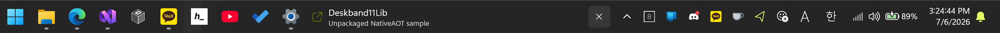

[](https://db11l.kagamine-rin.com)

[](https://www.nuget.org/packages/Deskband11Lib.WinUI)
[](https://www.nuget.org/packages/Deskband11Lib.Wpf)
[](https://github.com/airtaxi/Deskband11Lib/actions/workflows/pack-and-publish.yml)
[](https://github.com/airtaxi/Deskband11Lib/blob/master/LICENSE)

🌐 [English](https://github.com/airtaxi/Deskband11Lib/blob/master/README.md) | 한국어

Deskband11Lib는 Windows 11 작업 표시줄 안에 앱 UI를 자연스럽게 올릴 수 있게 해주는 라이브러리입니다. 작은 대시보드, 빠른 제어 패널, 상태 표시기, 미디어 위젯, 런처처럼 항상 눈에 띄어야 하는 기능을 데스크톱의 일부처럼 만들 수 있습니다.



## 패키지 구성

Deskband11Lib는 UI 프레임워크별 NuGet 패키지로 제공됩니다. 작업 표시줄에 붙이는 핵심 로직은 `Deskband11Lib.Core`에 들어 있고 WinUI와 WPF 패키지는 각 프레임워크에서 쓰기 쉬운 API를 제공합니다. 이후 Avalonia 같은 프레임워크도 같은 방식으로 추가할 수 있습니다.

| 패키지                   | 설명                                                                                                   |
| --------------------- | ---------------------------------------------------------------------------------------------------- |
| `Deskband11Lib.Core`  | 작업 표시줄 창 찾기, 레이아웃 계산, UI Automation 측정, Explorer 재시작 감지, Win32 HWND 호스팅을 담당합니다. UI 프레임워크에 의존하지 않습니다. |
| `Deskband11Lib.WinUI` | WinUI 3 앱용 패키지입니다. 앱에서 쓰던 WinUI 컨트롤, 스타일, Composition 기능으로 작업 표시줄 위젯을 만들 수 있습니다.                     |
| `Deskband11Lib.Wpf`   | WPF 앱용 패키지입니다. WPF로 만든 콘텐츠를 같은 방식으로 Windows 11 작업 표시줄에 배치할 수 있습니다.                                   |

## 주요 기능

- 앱에서 쓰는 컨트롤과 스타일을 그대로 활용해 작업 표시줄 위젯을 만들 수 있습니다.
- 별도 창을 열지 않아도 필요한 정보를 항상 보이는 위치에 띄울 수 있습니다.
- 타이머, 미디어 재생, 계정 전환, 빌드 상태, 장치 모니터링, 빠른 실행 같은 기능을 작게 정리해 배치하기 좋습니다.
- 고정 앱, 실행 중인 앱, 알림 영역과 겹치지 않도록 남는 작업 표시줄 공간에 맞춰 위치를 잡습니다.
- Windows 11 26H2부터 쓸 수 있는 위쪽, 왼쪽, 오른쪽 위치를 포함해 작업 표시줄의 모든 위치에서 동작합니다. 작업 표시줄을 옮기면 콘텐츠도 함께 따라갑니다.
- 같은 작업 표시줄 영역에 여러 인스턴스를 동시에 띄울 수 있습니다. 자동 슬롯 조정으로 각 인스턴스가 사용 가능한 공간을 겹치지 않고 나눕니다.
- 레이아웃이 바뀔 때 자연스럽게 움직이도록 기본 easing 함수를 제공합니다. Linear, Sine, Quadratic, Cubic, Quartic, Quintic, Exponential, Circle 계열을 사용할 수 있습니다.
- 고주사율 모드를 켜면 레이아웃 애니메이션 타이머를 대상 모니터의 현재 주사율에 맞춰 고주사율 디스플레이에서 더 매끄러운 움직임을 제공합니다.
- Explorer가 재시작되면 앱이 작업 표시줄 창을 다시 붙일 수 있도록 이벤트를 제공합니다.
- WinUI 패키지는 Windows App SDK 앱과 NativeAOT 게시를 지원합니다.

## 설치

사용 중인 UI 프레임워크에 맞는 패키지를 설치하시면 됩니다.

```powershell
# WinUI 3
dotnet add package Deskband11Lib.WinUI

# WPF
dotnet add package Deskband11Lib.Wpf
```

`Deskband11Lib.Core`는 필요한 경우 자동으로 함께 설치됩니다.

## 기본 사용법

### WinUI 3

WinUI 창을 만든 뒤 `TaskbarContentHost`에 연결합니다. 초기 작업 표시줄 레이아웃이 준비되면 창을 작업 표시줄에 붙이고 활성화합니다.

```csharp
using Deskband11Lib.Core;
using Deskband11Lib.WinUI;

var window = new MainWindow();
var host = new TaskbarContentHost(window, rootElement, new TaskbarContentHostOptions
{
    PreferredWidth = 360,
    PreferredHeight = 48
});

await host.AttachWhenLayoutReadyAsync();
window.Activate();
```

### WPF

WPF에서도 API 흐름은 같습니다. 차이는 `Window`와 `FrameworkElement`가 WPF 타입이라는 점뿐입니다.

```csharp
using Deskband11Lib.Core;
using Deskband11Lib.Wpf;

var window = new MainWindow();
var host = new TaskbarContentHost(window, rootElement, new TaskbarContentHostOptions
{
    PreferredWidth = 360,
    PreferredHeight = 48
});

await host.AttachWhenLayoutReadyAsync();
window.Show();
```

### 창 재생성

작업 표시줄에 붙어 있던 창이 사라지는 경우는 몇 가지가 있습니다. Explorer가 재시작되거나, 위젯을 붙여 둔 모니터의 연결이 끊기거나, 시스템 DPI가 바뀌는 경우입니다. 어느 쪽이든 해결 방법은 같습니다. 창을 새로 만들어 다시 붙이면 됩니다. `TaskbarWindowRecreationRequired`는 이 세 경우를 모두 묶어서 발생하므로, 대부분의 앱은 핸들러 하나만 등록하면 됩니다.

```csharp
host.TaskbarWindowRecreationRequired += async (_, _) =>
{
    await RecreateMainWindowAsync();
};
```

어떤 이유로 창이 사라졌는지 구분해서 처리해야 한다면 아래 개별 이벤트를 쓰면 됩니다. 개별 이벤트는 통합 이벤트와 함께 발생합니다.

### Explorer 재시작

Explorer가 재시작되면 작업 표시줄에 붙어 있던 자식 창도 사라집니다. 이때는 `TaskbarWindowRecreated` 이벤트에서 창을 다시 만들어 붙이면 됩니다.

```csharp
host.TaskbarWindowRecreated += async (_, _) =>
{
    await RecreateMainWindowAsync();
};
```

### DPI 변경

시스템 DPI가 바뀌면 작업 표시줄은 새 DPI로 넘어가는데 호스팅된 창은 예전 DPI를 그대로 물고 있는 경우가 있습니다. 이러면 위젯 위치가 어긋납니다. Deskband11Lib는 작업 표시줄과 호스팅 창의 DPI를 주기적으로 비교하다가 값이 달라지면 창을 숨기고 분리한 뒤 `TaskbarDpiChanged`를 발생시킵니다. 이 이벤트에서 창을 새로 만들어 붙이면 새 DPI에 맞춰 다시 배치됩니다.

```csharp
host.TaskbarDpiChanged += async (_, _) =>
{
    await RecreateMainWindowAsync();
};
```

### 보조 모니터 연결 해제

위젯을 붙여 둔 보조 모니터의 연결이 끊기면 작업 표시줄이 자식 창을 파괴하고, 라이브러리는 `TaskbarWindowDisappeared`를 발생시킵니다. `TaskbarWindowRecreated`와 마찬가지로 이 이벤트에서 창을 다시 만들어 붙이면 됩니다. 그러면 선호 모니터를 쓸 수 없는 동안 새 호스트가 기본 작업 표시줄로 폴백합니다.

```csharp
host.TaskbarWindowDisappeared += async (_, _) =>
{
    await RecreateMainWindowAsync();
};
```

보조 모니터가 다시 연결되면 `TaskbarWindowRecreated`가 발생하고, 새로 만든 창이 보조 모니터의 작업 표시줄에 붙습니다.

## 다중 인스턴스 슬롯 조정

Deskband11Lib는 같은 작업 표시줄 영역에 여러 인스턴스를 동시에 실행할 수 있도록 지원합니다. 여러 인스턴스가 같은 모니터의 같은 배치 영역을 대상으로 하면, 공유 메모리 슬롯 레지스트리를 통해 자동으로 조정되어 사용 가능한 공간을 겹치지 않고 나눕니다.

### 슬롯 할당

등록된 각 인스턴스를 **슬롯**이라고 합니다. 슬롯은 `(ManualSlotPriority, SlotIndex)` 순으로 정렬됩니다. `ManualSlotPriority` 값이 낮을수록 인스턴스가 더 앞에 배치됩니다(왼쪽 정렬 모드에서 알림 영역에서 더 먼 쪽). `ManualSlotPriority`가 같은 슬롯 중에서는 도착 순서(`SlotIndex`)가 우선순위를 결정합니다.

너비 할당은 Fixed-then-Stretch 모델을 따릅니다. 여기서 너비는 작업 표시줄을 따라가는 방향의 길이이며, 왼쪽이나 오른쪽 작업 표시줄에서는 높이를 뜻합니다([작업 표시줄 위치](#작업-표시줄-위치) 참고).

- **Fixed 슬롯**: 유한한 `PreferredWidth`를 가진 인스턴스는 우선순위 순서대로 요청한 너비를 할당받습니다. 사용 가능한 공간이 부족하면 우선순위가 낮은 Fixed 슬롯은 남은 공간만 받습니다(0이 될 수도 있음).
- **Stretch 슬롯**: `PreferredWidth = double.MaxValue`로 설정된 인스턴스는 모든 Fixed 슬롯이 할당된 후 남은 공간을 균등하게 나눕니다.

`AllowFixedSlotResize`가 `true`(기본값)이면, 공간이 부족할 때 해당 Fixed 슬롯들이 너비가 0이 되지 않고 `PreferredWidth` 비율에 맞춰 줄어듭니다. `AllowFixedSlotResize = false`로 설정한 Fixed 슬롯은 기존대로 우선순위 순서대로 먼저 할당받습니다. Stretch 슬롯은 항상 Fixed 슬롯 할당이 끝난 뒤 남은 공간을 나눕니다.

빈 슬롯이 생기면 그 자리는 빈 공간으로 남습니다. 나머지 인스턴스가 자동으로 채우지 않습니다.

### 수동 슬롯 우선순위

기본적으로 모든 인스턴스의 `ManualSlotPriority`는 `65535`이며, 도착 순서대로만 정렬됩니다. 값을 낮추면 해당 인스턴스를 자동 정렬 인스턴스보다 앞에 배치할 수 있습니다:

```csharp
var host = new TaskbarContentHost(window, rootElement, new TaskbarContentHostOptions
{
    PreferredWidth = 200,
    ManualSlotPriority = 100
});
```

### Stretch 모드

`PreferredWidth`를 `double.MaxValue`로 설정하면 Fixed 슬롯 할당 후 남은 공간을 모두 채우도록 인스턴스를 늘일 수 있습니다:

```csharp
var host = new TaskbarContentHost(window, rootElement, new TaskbarContentHostOptions
{
    PreferredWidth = double.MaxValue
});
```

같은 영역의 모든 인스턴스가 Stretch이면 공간을 균등하게 나눕니다.

## 작업 표시줄 위치

Windows 11 26H2부터는 작업 표시줄을 화면의 네 가장자리 어디에나 둘 수 있습니다. Deskband11Lib는 네 위치를 모두 지원합니다. 위쪽 작업 표시줄은 아래쪽 작업 표시줄과 같은 방식으로 동작합니다. 왼쪽이나 오른쪽 작업 표시줄은 세로 방향이므로 콘텐츠를 위에서 아래로 배치합니다.

### 크기는 작업 표시줄 방향을 기준으로 합니다

`PreferredWidth`와 `PreferredHeight`는 어느 위치에서든 이름이 같지만, 화면이 아니라 작업 표시줄을 기준으로 방향을 나타냅니다.

| 옵션                | 방향                                  | 아래쪽 또는 위쪽 작업 표시줄 | 왼쪽 또는 오른쪽 작업 표시줄 |
| ----------------- | ----------------------------------- | ---------------- | ---------------- |
| `PreferredWidth`  | 작업 표시줄을 따라가는 방향                     | 너비               | 높이               |
| `PreferredHeight` | 작업 표시줄을 가로지르는 방향(작업 표시줄 두께를 넘지 않음) | 높이               | 너비               |

`PreferredWidth`를 기준으로 동작하는 기능도 같은 규칙을 따릅니다. Stretch 모드(`double.MaxValue`), `AllowFixedSlotResize`, `ManualSlotPriority`, 다중 인스턴스 슬롯 할당은 모두 작업 표시줄을 따라가는 방향으로 동작하므로, 세로 작업 표시줄을 위해 따로 바꿀 설정이 없습니다.

반면 콘텐츠 요소에는 화면 기준의 실제 크기가 적용됩니다. 왼쪽이나 오른쪽 작업 표시줄에서는 라이브러리가 `FrameworkElement.Width`에 배정한 두께를, `FrameworkElement.Height`에 배정한 길이를 설정합니다. 기본 옵션(`PreferredWidth = 360`, `PreferredHeight = 48`)을 쓰면, 너비가 48 epx인 세로 작업 표시줄에서 콘텐츠의 너비는 48 epx가 되고 높이는 최대 360 epx가 됩니다.

세로 작업 표시줄은 작업 표시줄 단추를 합치지 않고 레이블을 표시하도록 설정하면 훨씬 넓어집니다. 이때도 콘텐츠의 너비는 `PreferredHeight`를 넘지 않습니다. 어느 위치에서든 작업 표시줄 두께를 꽉 채우려면 `PreferredHeight = double.MaxValue`로 설정하시면 됩니다. 아래쪽이나 위쪽 작업 표시줄에서는 이렇게 설정해도 높이가 작업 표시줄 두께를 넘지 않습니다.

세로 작업 표시줄에서는 알림 영역의 아이콘이 세로로 쌓여서 작업 표시줄의 상당 부분을 차지합니다. 그래서 남는 공간이 가로 작업 표시줄보다 짧은 경우가 많으므로, 세로 레이아웃은 짧은 길이에 맞춰 설계하는 편이 좋습니다.

### 배치와 정렬

`Placement`와 `TaskbarAlignment` 값도 이름을 그대로 쓰며, 작업 표시줄을 따라가는 방향으로 해석합니다.

| 값                        | 아래쪽 또는 위쪽 작업 표시줄     | 왼쪽 또는 오른쪽 작업 표시줄     |
| ------------------------ | -------------------- | -------------------- |
| `TaskbarAlignment.Left`  | 아이콘을 왼쪽으로 정렬한 상태     | 아이콘을 위쪽으로 정렬한 상태     |
| `LeftEdge`               | 날씨 위젯 오른쪽, 가장 왼쪽 끝   | 날씨 위젯 아래쪽, 가장 위쪽 끝   |
| `BeforeStartButton`      | 시작 버튼 왼쪽             | 시작 버튼 위쪽             |
| `BeforeNotificationArea` | 알림 영역 왼쪽             | 알림 영역 위쪽             |

### 위치 변경에 대응하기

작업 표시줄 위치를 바꿔도 작업 표시줄 창은 다시 만들어지지 않습니다. 따라서 호스팅된 창은 그대로 붙어 있고, 다음 레이아웃 갱신 때 새 위치에 맞춰 다시 배치됩니다. 콘텐츠를 가로 레이아웃과 세로 레이아웃 사이에서 전환하려면 다음 멤버를 사용하시면 됩니다.

- `TaskbarEdge`: 작업 표시줄이 붙어 있는 가장자리(`Left`, `Top`, `Right`, `Bottom`)입니다. 첫 레이아웃을 계산하기 전까지는 `Unknown`입니다.
- `IsTaskbarVertical`: 작업 표시줄이 왼쪽이나 오른쪽에 있으면 `true`입니다.
- `TaskbarEdgeChanged`: 새 위치에 맞는 크기를 적용하기 직전에 UI 스레드에서 발생합니다. 연결한 뒤 처음 레이아웃을 계산할 때도 발생합니다.

```csharp
host.TaskbarEdgeChanged += (_, _) =>
{
    // Switch the content between its horizontal and vertical layouts.
    content.ApplyTaskbarOrientation(host.IsTaskbarVertical);
};
```

`ApplyTaskbarOrientation`은 앱의 콘텐츠에서 직접 구현하는 메서드를 뜻합니다. 샘플 프로젝트에서는 가로 레이아웃과 세로 레이아웃을 하나씩 두고 표시 여부를 바꾸는 방식으로 구현했습니다.

작업 표시줄이 가로와 세로 사이에서 바뀔 때는 레이아웃 애니메이션을 생략합니다.

## 동작 방식

Deskband11Lib는 앱 창을 작업 표시줄 안에 들어갈 크기로 맞추고 실제 작업 표시줄 레이아웃이 바뀔 때마다 위치를 다시 잡습니다. 내부적으로는 일반적인 Win32 창 부모 관계를 사용합니다.

- 기본 작업 표시줄 창인 `Shell_TrayWnd`를 찾거나, `PreferredMonitorIdentity` 값에 따라 보조 모니터의 작업 표시줄 창인 `Shell_SecondaryTrayWnd`를 찾습니다.
- 앱에서 만든 일반 `Window`를 받습니다.
- 창 스타일을 최상위 팝업 창에서 자식 창 스타일로 바꿉니다.
- `SetParent`로 창을 작업 표시줄의 자식 창으로 붙입니다.
- 작업 표시줄 창과 그 창이 있는 모니터를 비교해서 작업 표시줄이 어느 가장자리에 있는지 판정합니다.
- 작업 표시줄을 따라가는 방향으로 작업 표시줄 버튼과 알림 영역 사이에서 사용할 수 있는 영역을 계산하며, 작업 표시줄 정렬(왼쪽이나 위쪽, 또는 가운데)을 함께 고려합니다.
- `SetWindowPos`와 `SetWindowRgn`으로 창 위치와 클리핑 영역을 조정합니다.

현재 Windows 11에서는 작업 표시줄의 자식 HWND만 살펴봐서는 실제 버튼 폭을 안정적으로 알기 어렵고 작업 표시줄 콘텐츠 정렬이 왼쪽일 수도 있고 가운데일 수도 있습니다. Deskband11Lib는 이 문제를 UI Automation으로 해결합니다.

- **버튼 감지:** UI Automation으로 시작 버튼(`AutomationId = StartButton`), 있으면 날씨 위젯(`WidgetsButton`), 그리고 오른쪽으로 이어지는 작업 표시줄 앱 버튼 묶음을 정확히 찾아냅니다.
- **정렬 감지:** 레지스트리의 `TaskbarAl` 값으로 작업 표시줄 정렬을 읽고, 실패하면 시작 버튼 위치로 추정합니다.
- **공간 선택:** 가운데 정렬일 때는 시작 버튼 그룹 양쪽의 남는 공간 중 더 넓은 쪽에 콘텐츠를 배치하므로 시작 버튼, 앱 버튼, 날씨 위젯, 알림 영역 어느 것도 가리지 않습니다.
- **보조 모니터:** 알림 영역 전용 HWND가 없으므로 UI Automation이 시계와 알림 묶음(`AutomationId = SystemTrayIcon` / `NotifyItemIcon`)까지 찾아 남는 공간이 끝나는 위치를 계산합니다.

## 옵션

모든 옵션은 `Deskband11Lib.Core.TaskbarContentHostOptions`에 정의되어 있고 WinUI와 WPF 패키지에서 공통으로 사용합니다.

| 옵션                        | 기본값                         | 설명                                                                                                                          |
| ------------------------- | --------------------------- | --------------------------------------------------------------------------------------------------------------------------- |
| `PreferredWidth`          | `360`                       | 작업 표시줄을 따라가는 방향으로 콘텐츠가 사용할 길이입니다. effective pixel 단위이며, 아래쪽이나 위쪽 작업 표시줄에서는 너비, 왼쪽이나 오른쪽 작업 표시줄에서는 높이입니다. `double.MaxValue`로 설정하면 stretch 모드로 동작하여 Fixed 너비 인스턴스 할당 후 남은 공간을 채웁니다. [작업 표시줄 위치](#작업-표시줄-위치)를 참고하세요. |
| `AllowFixedSlotResize`   | `true`                      | `true`이면 공간이 부족할 때 Fixed 슬롯이 너비 0까지 줄지 않고 `PreferredWidth` 비율에 맞춰 줄어듭니다. `false`로 설정하면 기존대로 우선순위 순서대로 먼저 할당받습니다. |
| `PreferredHeight`         | `48`                        | 작업 표시줄을 가로지르는 방향으로 콘텐츠가 사용할 크기입니다. effective pixel 단위이며, 아래쪽이나 위쪽 작업 표시줄에서는 높이, 왼쪽이나 오른쪽 작업 표시줄에서는 너비입니다. 작업 표시줄 두께를 넘지 않으며, `double.MaxValue`로 설정하면 두께를 꽉 채웁니다. |
| `AnimateLayoutChanges`    | `true`                      | 작업 표시줄 안에서 위치나 크기가 바뀔 때 애니메이션을 적용합니다.                                                                                       |
| `HighRefreshRateMode`     | `false`                     | `AnimateLayoutChanges`와 함께 활성화하면 레이아웃 애니메이션 타이머 주기를 기본 60 FPS가 아닌 대상 모니터의 현재 주사율에 맞춥니다. |
| `LayoutAnimationDuration` | `500`                       | 레이아웃 애니메이션 시간입니다. ms 단위입니다.                                                                                                 |
| `LayoutAnimationEasing`   | `EasingFunctions.CircleOut` | 레이아웃 애니메이션에 사용할 easing delegate(`Func<double, double>`)입니다. 오버슛 없는 기본 easing은 `Deskband11Lib.Core.EasingFunctions`에서 제공합니다. |
| `Placement`               | `Auto`                      | 배치 방식을 선택합니다.<br>• `Auto`: 가운데 정렬일 때 시작 버튼 그룹 양쪽 남는 공간 중 더 넓은 쪽에 배치합니다. 왼쪽이 더 넓으면 가장 왼쪽 끝(`LeftEdge`와 동일), 오른쪽이 더 넓으면 알림 영역 앞에 둡니다. 왼쪽 정렬일 때는 `BeforeNotificationArea`로 동작합니다.<br>• `LeftEdge`: 가운데 정렬일 때 날씨 위젯 바로 오른쪽, 가장 왼쪽 끝에 둡니다. 왼쪽 정렬일 때는 `BeforeNotificationArea`로 동작합니다.<br>• `BeforeNotificationArea`: 항상 알림 영역 앞에 둡니다.<br>• `BeforeStartButton`: 시작 버튼 앞에 둡니다. 가운데 정렬이 아니면 `BeforeNotificationArea`로 동작합니다.<br>왼쪽이나 오른쪽 작업 표시줄에서는 같은 값을 위에서 아래 방향으로 해석합니다. `LeftEdge`는 가장 위쪽 끝이고, "앞"은 위쪽을 뜻합니다. |
| `TrackTaskbarButtons`     | `true`                      | UI Automation으로 작업 표시줄 버튼 영역을 추적합니다.                                                                                        |
| `TrackNotificationArea`   | `true`                      | 콘텐츠가 알림 영역을 침범하지 않도록 합니다.                                                                                                   |
| `PreferredMonitorIdentity` | `0`                        | 어느 작업 표시줄에 호스팅할지 선택합니다. `0`이면 기본 작업 표시줄(`Shell_TrayWnd`)을 씁니다. `1`이면 첫 번째 보조 모니터의 작업 표시줄(`Shell_SecondaryTrayWnd`), `2`면 그 다음, 화면 왼쪽부터 오른쪽 순서로 매핑됩니다. 요청한 보조 모니터의 작업 표시줄이 없으면 기본 작업 표시줄로 폴백합니다. |
| `ManualSlotPriority`      | `65535`                     | 여러 인스턴스가 같은 작업 표시줄 영역을 공유할 때 순서를 결정합니다. 값이 낮을수록 인스턴스가 더 앞에 배치됩니다(왼쪽 정렬 시 알림 영역에서 먼 쪽). 같은 값을 가진 인스턴스는 도착 순서로 정렬됩니다. 기본값 `65535`는 도착 순서 자동 정렬을 의미합니다. |
| `LayoutRefreshInterval`   | `500 ms`                    | 작업 표시줄 레이아웃을 다시 확인하는 주기입니다.                                                                                                 |

## 작업 표시줄 정렬

Deskband11Lib는 레지스트리의 `TaskbarAl` 값을 읽어 Windows 11 작업 표시줄이 왼쪽 정렬인지 가운데 정렬인지 감지하고 실패하면 시작 버튼 위치로 추정합니다. `TaskbarContentHost`에서 `GetTaskbarAlignment()`를 호출하면 `TaskbarAlignment`(`Left`, `Center`, `Unknown`) 값을 얻을 수 있습니다. 감지된 정렬은 `Placement = Auto`의 동작을 결정합니다. 왼쪽이나 오른쪽 작업 표시줄에서 `Left`는 아이콘이 위쪽으로 정렬된 상태를 뜻합니다.

## 내장 Easing 함수

`Deskband11Lib.Core.EasingFunctions`에는 `LayoutAnimationEasing`에 바로 넣을 수 있는 easing 함수들이 준비되어 있습니다.

- `EasingFunctions.Linear`
- `EasingFunctions.SineIn` / `SineOut` / `SineInOut`
- `EasingFunctions.QuadraticIn` / `QuadraticOut` / `QuadraticInOut`
- `EasingFunctions.CubicIn` / `CubicOut` / `CubicInOut`
- `EasingFunctions.QuarticIn` / `QuarticOut` / `QuarticInOut`
- `EasingFunctions.QuinticIn` / `QuinticOut` / `QuinticInOut`
- `EasingFunctions.ExponentialIn` / `ExponentialOut` / `ExponentialInOut`
- `EasingFunctions.CircleIn` / `CircleOut` / `CircleInOut`

필요하면 직접 작성한 `Func<double, double>` delegate를 넘겨도 됩니다.

## 샘플 프로젝트

위 코드는 핵심 API만 보여주는 최소 예제입니다. 실제 작업 표시줄 앱을 만들 때는 창 수명주기, 시작 순서, Explorer 재시작 복구, 프레임워크별 호스팅 처리가 중요하므로 샘플 프로젝트를 먼저 참고하시는 것을 권장합니다.

- `Deskband11Lib.WinUI.Sample`: WinUI 3 및 Windows App SDK 앱용 샘플입니다.
- `Deskband11Lib.Wpf.Sample`: WPF 앱용 샘플입니다. 테두리 없는 투명 호스트 창 설정도 포함되어 있습니다.

## 요구 사항

- Windows 11.
- 선택한 UI 프레임워크와 호환되는 대상 프레임워크.
- WinUI 3는 Windows App SDK가 필요합니다.
- WPF는 프로젝트 파일에 `UseWPF=true`가 필요합니다.

## 프로젝트 개발

```powershell
dotnet restore
dotnet build Deskband11Lib.slnx -c Debug
dotnet publish Deskband11Lib.WinUI.Sample\Deskband11Lib.WinUI.Sample.csproj -c Release -r win-x64
```

## 감사의 말

[zadjii](https://github.com/zadjii)와 [Deskband11](https://github.com/zadjii/Deskband11)에 감사드립니다. Windows 11 작업 표시줄 안에 앱 콘텐츠를 올린다는 핵심 아이디어는 해당 프로젝트에서 시작되었고 Deskband11Lib도 그 훌륭한 발상에서 큰 영감을 받았습니다.

Deskband11Lib는 [FOSS for All(포스포올)](https://fossforall.org)의 [Microgrants 2026](https://forum.fossforall.org/t/foss-for-all-microgrants-2026/162) 지원 사업으로부터 후원을 받고 있습니다. 자유 오픈소스 생태계를 지원해 주시는 FOSS for All과 기부자 여러분께 감사드립니다.

## 라이선스

Deskband11Lib는 [MIT License](https://github.com/airtaxi/Deskband11Lib/blob/master/LICENSE)로 배포됩니다.

## 작성자

[Howon Lee (airtaxi)](https://github.com/airtaxi)가 만들었습니다.
